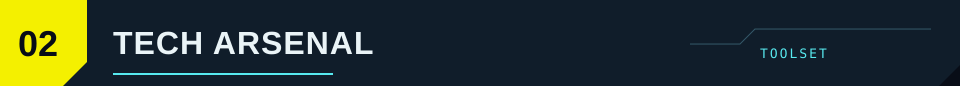
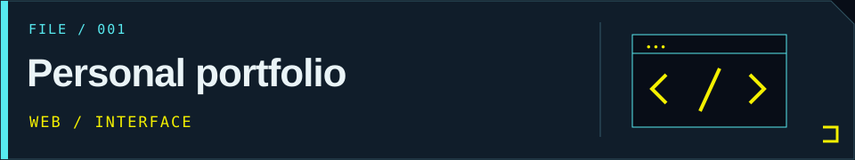
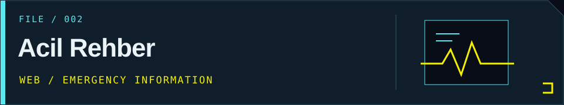
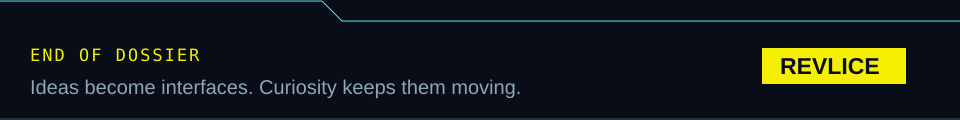

  

[Website](https://rahmicantut.com/) · [GitHub](https://github.com/Revlice) · [LinkedIn](https://www.linkedin.com/in/rahmican-tut-37a165265/)

## 

I'm **Rahmican Tut**, also known as **Revlice**. My background is in web development: turning ideas into interfaces and tools people can use.

I'm exploring game development and the systems behind game servers. I'm working on **Cyberpunk roleplay systems for Open2077**. Automotive design and Cyberpunk worlds influence my taste for purposeful details and expressive interfaces.

Beyond development, I'm a **paramedic**.

## 

**Tools I've worked with**

- **Web foundations** — HTML · CSS · JavaScript · TypeScript
- **Interfaces** — React · Next.js · Tailwind CSS
- **Backend &amp; data** — Node.js · Express · MongoDB · Supabase
- **Development assistants** — Codex · Claude

**Exploring &amp; building on**

Game development, game server systems and roleplay mechanics. My game-related toolkit includes Lua, C# and Unity.

## 

### [Personal portfolio](https://github.com/Revlice/rahmicantut.com-v2)

My personal website project: a place to introduce myself and my work.

**Stack:** React · Vite · Tailwind CSS · Framer Motion  
[Browse source](https://github.com/Revlice/rahmicantut.com-v2) · [Visit my current website](https://rahmicantut.com/)

### [Acil Rehber](https://acilrehber.com.tr/)

A Turkish-language web platform for browsing first aid and emergency information through searchable, categorized guides.

[Visit Acil Rehber](https://acilrehber.com.tr/)

## 

I'm open to job opportunities, freelance projects and conversations about the web, games or server systems.

**[Explore my website ↗](https://rahmicantut.com/)**  
**[Connect on LinkedIn ↗](https://www.linkedin.com/in/rahmican-tut-37a165265/)**  
[Find me on GitHub](https://github.com/Revlice) · [Buy me a coffee](https://www.buymeacoffee.com/revlice)

