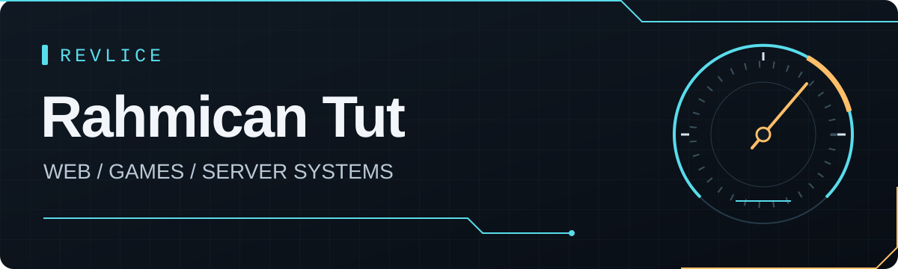

  

# Rahmican Tut

**Web development · Game development · Game server systems**

I build for the web and explore game development and the systems behind game servers. I enjoy turning ideas into interfaces and tools people can use.

[Website](https://rahmicantut.com/) · [LinkedIn](https://www.linkedin.com/in/rahmican-tut-37a165265/) · [GitHub](https://github.com/Revlice)

## What drives me

The web is where I started building. Games and server systems are where I want to take that curiosity next. Cyberpunk worlds and automotive design influence my taste: purposeful details, clear interfaces, and a little edge.

Beyond development, I'm a paramedic.

## Tools I work with

**Web foundations**  
HTML · CSS · JavaScript · TypeScript

**Interfaces & applications**  
React · Next.js · Tailwind CSS

**Games & server scripting**  
Lua · C# · Unity

**AI development tools**  
Codex · Claude

## Let's build something

I'm open to job opportunities, freelance projects, and connecting with developers working on the web, games, or server systems.

[Explore my website](https://rahmicantut.com/) or [get in touch on LinkedIn](https://www.linkedin.com/in/rahmican-tut-37a165265/).

---

[Buy me a coffee](https://www.buymeacoffee.com/revlice) · Thanks for supporting what I build.
